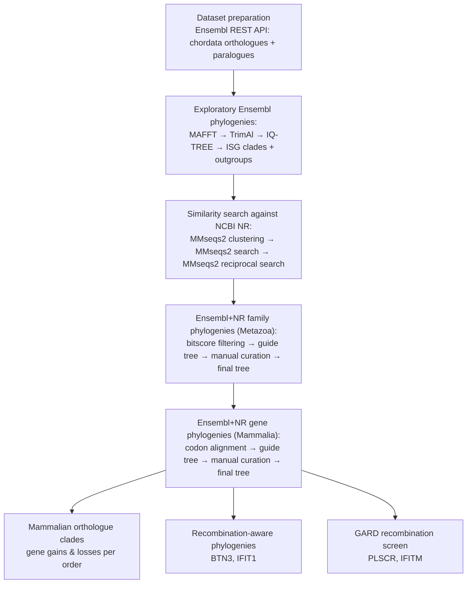

# Evolutionary origins of antiviral interferon-stimulated genes

This repository contains the data, scripts and notebooks behind a phylogenetic analysis of the evolutionary origins of 35 antiviral interferon-stimulated genes (ISGs). For each ISG we gathered its chordata orthologues and paralogues from Ensembl and used them to search NCBI NR across the tree of life. We then reconstructed protein family phylogenies across Metazoa and gene phylogenies within Mammalia to trace the origin of each gene arose and its expansions and losses.

## Contents

- [Background](#background)
- [Workflow overview](#workflow-overview)
- [Repository structure](#repository-structure)
- [IFITM family example](#ifitm-family-example)
- [Reproducing the analysis](#reproducing-the-analysis)
- [Software](#software)
- [External data](#external-data)
- [Notes on manual curation](#notes-on-manual-curation)
- [Licence](#licence)
- [Contact](#contact)

## Background

We started from 33 ISGs that showed direct antiviral activity across several mammalian species without being cytotoxic or amplifying IFN signalling when overexpressed. These were identified by the Palmarini and Wilson groups at the MRC-University of Glasgow Centre for Virus Research by screening ISG libraries from *Homo sapiens*, *Macaca mulatta* and *Bos taurus* against 25 viruses (in preparation). We added two more ISGs, RNF213 and ZNFX1 ([Ahel et al. 2025](https://doi.org/10.1038/s41467-025-59444-4); [Squair et al. 2026](https://doi.org/10.1016/j.molcel.2026.02.015)).

Some ISGs belong to the same family of paralogues (for example, IFITM1/2/3 or OAS1/2/3). We analysed these together as one **protein family**: an ISG of interest plus its paralogues. This is why the repository has 27 gene family folders and not 35.

## Workflow overview



## Repository structure

```
.
├── <FAMILY>/                              # One folder per protein family (27 in total)
│   ├── exploratory_phylogenies/           # Ensembl exploratory trees used to find ISG clades and outgroups
│   ├── mmseqs_search/                     # MMseqs2 clustering, NCBI NR search and reciprocal search results
│   ├── curated_phylogenies/               # Curated Metazoa family trees and Mammalia gene trees
│   └── gard_recombination_analysis/       # Recombination analysis (IFITM and PLSCR only)
│
├── additional_files/
│   ├── ensembl_gene_ids/                  # Ensembl IDs of the ISGs and their paralogues (input for Ensembl REST API)
│   ├── gene_expansions_and_losses/        # Per-species copy-number tables for mammalian orders
│   ├── human_isg_clusters/                # Genome positions of human ISGs in genes clusters
│   ├── human_isg_domains/                 # Curated domain annotations of human ISGs
│   ├── mmseqs_data/                       # MMseqs2 cluster representatives and search results
│   ├── ncbi_mammalian_genome_assemblies/  # NCIB stats on mammalian genome assemblies
│   └── tree_of_life/                      # Taxonomy used to order the coverage heatmaps
│
├── scripts/
│   ├── exploratory_ensembl_phylogenies/   # Scripts for processing Ensembl records
│   ├── mmseqs_nr_search/                  # Scripts for MMseqs2 clustering and search
│   └── curated_ensembl_nr_phylogenies/    # Scripts for producing final phylogenies
│
├── jupyter_notebooks/                     # Notebols used for the analysis, filtering, and producing figures
├── figures/                               # Figures presenting analysis results
│
├── CITATION.cff
├── LICENSE                                # Licence for code
├── LICENSE-DATA                           # Licence for data
└── README.md
```

The 27 family folders are: BST2, BTN3, DRAM1, EHD4, HAS3, IFI6, IFIT1, IFITM, ISG20, MX, OAS, PARP12_ZC3HAV1, PLAC8, PLSCR, RNF19, RNF213, RSAD2, RTP, SCARB2, SHFL, SHISA5, TMEM140, TRIM25, TRIM5, TTC39B, UBA7 and ZNFX1. A folder named after two genes (PARP12_ZC3HAV1) holds a family that contains two ISGs of interest.

Every family folder has the same layout, so once you know your way around one you can navigate them all.

## IFITM family example

The IFITM family is a good example because its analysis goes through every step of the pipeline, including the recombination screen.

### File naming conventions

A few conventions are used throughout the repository:

- **The leading number is the number of sequences** in the file. For example, `479_IFITM_ensembl_curated.fasta` holds 479 sequences.
- **Gene names in a file name** list the ISGs of interest in that family (`IFITM1_IFITM2_IFITM3`). In exploratory files, the names list every family member pulled from Ensembl (`IFITM1_IFITM10_IFITM2_IFITM3_IFITM5`).
- **Suffixes record the processing steps applied, in order**, e.g. `.trimal.pal2nal.mafft.fasta` is a MAFFT alignment, converted to codons with PAL2NAL, then trimmed with TrimAl.
- **Phylogeny folders are named after the run**: `iqtree_fast_guide_tree` for guide trees and `iqtree_ufboot_alrt` for final trees (1000 UFBoot + 1000 SH-aLRT). The suffix `_nt` marks nucleotide trees, and `_ref` marks alignments with columns that have a gap in the human reference sequence removed.

### IFITM folder

```
IFITM/
├── exploratory_phylogenies/                       # Ensembl exploratory trees used to find ISG clades and outgroups
│   ├── 665_ENSG00000300510_..._ensembl.fasta                       # Canonical sequences of IFITM orthologues and paralogues from Ensembl
│   ├── ENSG00000300510_..._ensembl_homology_table.csv              # Ensembl Compara homology data
│   ├── ENSG00000300510_..._ensembl_master_table.csv                # Ensembl sequence and metadata
│   ├── ENSG00000300510_..._ensembl_master_table_annotation.tsv     # annotation used to label exploratory trees
│   └── provisional_phylogeny/                                      # MAFFT + TrimAl + IQ-TREE exploratory tree
│
├── mmseqs_search/                                 # MMseqs2 clustering, NCBI NR search and reciprocal search results
│   ├── 479_IFITM_ensembl_curated.fasta                             # Ensembl ISG clades + outgroup picked from the exploratory tree
│   ├── 196_IFITM1_IFITM2_IFITM3_mmseqs_probes.fasta                # Ensembl ISG clades used as probes for clustering and search
│   ├── 196_..._mmseqs_probes_clustered_50-90_cluster.tsv           # Cluster membership (50% AA id, 90% bi-directional cov)
│   ├── 196_..._mmseqs_probes_clustered_50-90_all_seqs.fasta        # All sequences, grouped by cluster
│   ├── 196_..._mmseqs_probes_clustered_50-90_rep_seq.fasta         # Cluster representatives used to search NR
│   └── 4236_IFITM1_IFITM2_IFITM3_ensembl_nr_hits_processed.tsv     # Ensembl + NR hits that passed the reciprocal search
│
├── curated_phylogenies/                           # Curated Metazoa family trees and Mammalia gene trees
│   ├── 1162_..._metazoa_100_bitscore_filtered.fasta                # Metazoa hits kept after a bitscore threshold of 100
│   ├── 1172_..._metazoa_100_bitscore_filtered_with_outgroup.fasta  # The same set with the outgroup from Ensembl added back
│   ├── mmseqs_clustering/                                          # MMseqs2 clustering to reduce number of visualized sequences
│   ├── IFITM_family_chordata_iqtree_fast_guide_tree_1/             # First guide tree and curation round
│   ├── IFITM_family_chordata_iqtree_fast_guide_tree_2/             # Second guide tree and curation round
│   ├── IFITM_family_chordata_iqtree_ufboot_alrt_nt/                # Final family phylogeny
│   ├── 712_IFITM1_IFITM2_IFITM3_chordata_one_isoform.tsv           # Orthologue records after keeping one isoform per GenBank Gene ID
│   ├── IFITM_primates_iqtree_fast_guide_tree/                      # Guide tree for the within-primates gene phylogeny
│   └── IFITM_primates_iqtree_ufboot_alrt_nt_ref/                   # Final gene tree; human-gap columns removed
│
└── gard_recombination_analysis/                   # Recombination analysis
    ├── 19_IFITM_gard_protein_ids.txt                               # 19 IFITM paralogues from six species
    ├── 19_IFITM_gard_AA.fasta                                      # Their amino acid sequences
    ├── 19_IFITM_gard_NT.fasta                                      # Matching nucleotide sequences
    ├── 19_IFITM_gard_AA.mafft.fasta                                # AA alignment
    ├── 19_IFITM_gard_NT.pal2nal.mafft.fasta                        # Codon alignment
    ├── 19_IFITM_gard_NT.trimal.pal2nal.mafft.fasta                 # Trimmed codon alignment
    ├── 19_IFITM_gard_NT.trimal.colnumbering                        # Columns kept by TrimAl
    ├── 19_IFITM_gard_NT_curated.trimal.pal2nal.mafft.fasta         # Curated alignment used as GARD input
    ├── 19_IFITM_gard_NT_curated.json                               # GARD results
    ├── 19_IFITM_gard_NT_curated...best-gard                        # Best-fitting partitioned alignment
    └── 19_IFITM_gard_NT_curated...best-gard.fit.bf                 # Fitted model for the best partition
```

Each `iqtree_*` folder holds the input alignment for that run (untrimmed, trimmed and curated, where relevant) and the standard IQ-TREE outputs (`.treefile`, `.iqtree`, `.log`).

The other families follow the same layout, minus `gard_recombination_analysis/` (PLSCR has one too). The family and gene trees are named after the taxonomic group they cover (for example `chordata` or `primates`), so this part of the name differs between families. BTN3 and IFIT1 also hold alignments split into recombining and non-recombining regions.

## Reproducing the analysis

The steps below follow the order of the workflow. Every step reads from and writes to the family folder, so you can rerun one family at a time.

### 1. Download Ensembl sequences

Using the gene IDs in `additional_files/ensembl_gene_ids/`, download NT and AA sequences of the canonical transcript (one per gene) for every vertebrate orthologue and paralogue through the Ensembl REST API.

```bash
python scripts/exploratory_ensembl_phylogenies/get_ensembl_orthologs.py additional_files/ensembl_gene_ids
```

### 2. Exploratory Ensembl phylogenies

After downloading the AA sequences for the ISG of interest, construct maximum-likelihood phylogenies using MAFFT, TrimAl, and IQ-TREE.

```bash
# Step 1: MAFFT alignment
cd IFITM/exploratory_phylogenies/provisional_phylogeny
mafft --auto --reorder ../665_ENSG00000300510_IFITM1_IFITM10_IFITM2_IFITM3_IFITM5_ensembl.fasta > 665_ENSG00000300510_IFITM1_IFITM10_IFITM2_IFITM3_IFITM5.mafft.fasta

# Step 2: TrimAl processing
trimal -in 665_ENSG00000300510_IFITM1_IFITM10_IFITM2_IFITM3_IFITM5.mafft.fasta -out 665_ENSG00000300510_IFITM1_IFITM10_IFITM2_IFITM3_IFITM5.trimal.mafft.fasta -gt 0.05

# Step 3: IQ-TREE phylogeny
iqtree2 -s 665_ENSG00000300510_IFITM1_IFITM10_IFITM2_IFITM3_IFITM5.trimal.mafft.fasta -m MFP -B 1000
```

Each phylogeny is then inspected by eye to find the clade(s) containing the ISG of interest and a suitable outgroup. We refer to sequences in these clades as the **Ensembl hits** and store them in the corresponding `<FAMILY>/mmseqs_search/*_mmseqs_probes.fasta` files. We store **Ensembl hits** and suitable outgroups in `<FAMILY>/mmseqs_search/*_ensembl_curated.fasta` files.

### 3. Search NCBI NR

After identifying the **Ensembl hits**, cluster them using MMseqs2 and use the cluster representatives as probes for the MMseqs2 search against NR. Perfrom a reciproval MMseqs2 search of the hits against the human ISG to remove false positives.

```bash
# Step 1: MMseqs2 clustering of Ensembl hits
cd IFITM/mmseqs_search/
mmseqs easy-cluster 196_IFITM1_IFITM2_IFITM3_mmseqs_probes.fasta 196_IFITM1_IFITM2_IFITM3_mmseqs_probes_clustered_50-90 tmp --min-seq-id 0.5 --cov-mode 0 -c 0.9 -e 1e-4 --cluster-mode 0

# Step 2: MMseqs2 search of cluster representatives against NR
# MMseqs2 NCBI NR database is not provided in this repository 
# Raw MMseqs2 NCBI NR search results are shared through Zenodo
cd additional_files/mmseqs_data/
mmseqs easy-search 655_ensembl_probes_master_list_mmseqs_vs_nr.fasta mmseqs/NR 655_ensembl_probes_master_list_mmseqs_vs_nr_sensetive_250000_seqs_results.tsv tmp --split-memory-limit 500G -s 7.5 --max-seqs 250000 --format-mode 4 --format-output "query,target,theader,fident,alnlen,mismatch,gapopen,qstart,qend,qcov,qlen,tstart,tend,tcov,tlen,evalue,bits,taxid,taxname,taxlineage,tseq"

# Step 3: Reciprocal MMseqs2 search against the human ISG(s) to remove false positives
# Use AA sequences for ISG(s) as human probes
cd IFITM/mmseqs_search/
mmseqs easy-search human_probes.fasta 4313_IFITM1_IFITM2_IFITM3_ensembl_nr_hits.fasta 4313_IFITM1_IFITM2_IFITM3_ensembl_nr_hits_vs_human.tsv tmp --split-memory-limit 500G -s 7.5 --max-seqs 250000 --exhaustive-search --format-mode 4 --format-output "query,target,fident,alnlen,mismatch,gapopen,qstart,qend,qcov,qlen,tstart,tend,tcov,tlen,evalue,bits"
```

We refer to sequences that pass the reciprocal search as the **NR hits** and store them together with **Ensembl hits** in the corresponding `<FAMILY>/mmseqs_search/*_ensembl_nr_hits_processed.tsv` files.

### 4. Ensembl+NR family phylogenies (Metazoa)

1. Combine Ensembl and NR hits and keep only Metazoa.
2. For families with more than 2,000 Metazoa hits, apply the bitscore thresholds in `jupyter_notebooks/gene_family_phylogenies_bitscore_filtering.ipynb`. If there are still more than 2,000 sequences, cluster with MMseqs2 to bring the set down to 500–1,500 sequences.
    
    ```bash
    cd IFITM/curated_phylogenies/
    mmseqs easy-cluster 1172_IFITM1_IFITM2_IFITM3_metazoa_100_bitscore_filtered_with_outgroup.fasta mmseqs_clustering/1172_IFITM1_IFITM2_IFITM3_metazoa_100_bitscore_filtered_95-60 tmp --min-seq-id 0.95 --cov-mode 1 -c 60
    ```

3. Build a guide tree and curate:

   ```bash
   cd IFITM/curated_phylogenies/IFITM_family_chordata_iqtree_fast_guide_tree_1/
   mafft --auto 723_IFITM1_IFITM2_IFITM3_metazoa_100_bitscore_filtered_95-60.fasta > 723_IFITM1_IFITM2_IFITM3_metazoa_100_bitscore_filtered_95-60.mafft.fasta
   
   trimal -in 723_IFITM1_IFITM2_IFITM3_metazoa_100_bitscore_filtered_95-60.mafft.fasta -out 723_IFITM1_IFITM2_IFITM3_metazoa_100_bitscore_filtered_95-60.trimal.mafft.fasta -gt 0.1
   
   iqtree2 -s 723_IFITM1_IFITM2_IFITM3_metazoa_100_bitscore_filtered_95-60.trimal.mafft.fasta -m LG+G --fast
   ```

4. Remove distant clades and misaligned or truncated sequences by hand, then build the final tree. For genes that arose by duplication within Mammalia use PAL2NAL codon alignment:

   ```bash
   cd IFITM/curated_phylogenies/IFITM_family_chordata_iqtree_ufboot_alrt_nt/
   iqtree2 -s 661_IFITM1_IFITM2_IFITM3_NT_curated.pal2nal.trimal.fasta -m MFP -B 1000 -alrt 1000
   ```

### 5. Mammalian orthologue clades and gene trees

Orthologue clades for each of the 35 ISGs are picked from the family trees and expanded to include every MMseqs2 cluster member whose representative is in the clade, but keeping only mammalian records. Within a species we keep one NR hit per GenBank Gene ID (the one with the highest bitscore to the human ISG), and prefer the Ensembl record where both exist. This filtering is done in `jupyter_notebooks/gene_tree_phylogenies_isoform_filtering.ipynb`. The results are stored in corresponding `<FAMILY>/curated_phylogenies/*_one_isoform.tsv` files and later used for the analysis of gains and losses per mammalian order which is summarised in `jupyter_notebooks/gene_expansions_and_lossess_hetmap.ipynb`.

```bash
cd IFITM/curated_phylogenies/IFITM_family_chordata_iqtree_fast_guide_tree_2/

mafft --auto 712_IFITM1_IFITM2_IFITM3_AA_curated.fasta > 712_IFITM1_IFITM2_IFITM3_AA_curated.mafft.fasta

pal2nal.pl 712_IFITM1_IFITM2_IFITM3_AA_curated.mafft.fasta 712_IFITM1_IFITM2_IFITM3_NT_curated.fasta -output fasta > 712_IFITM1_IFITM2_IFITM3_AA_curated.pal2nal.fasta

trimal -in 712_IFITM1_IFITM2_IFITM3_AA_curated.pal2nal.fasta -out 712_IFITM1_IFITM2_IFITM3_AA_curated.pal2nal.trimal.fasta -gt 0.1

# guide tree
iqtree2 -s 712_IFITM1_IFITM2_IFITM3_AA_curated.pal2nal.trimal.fasta -m GTR+G --fast

# final tree: manual curation + removal of columns with a gap in the human orthologue
cd IFITM/curated_phylogenies/IFITM_family_chordata_iqtree_ufboot_alrt_nt/
iqtree2 -s 661_IFITM1_IFITM2_IFITM3_NT_curated.pal2nal.trimal.fasta -m MFP -B 1000 -alrt 1000   
```

### 6. GARD recombination screen (IFITM, PLSCR)

Use IFITM paralogs from 6 species spanning different orders (_Homo sapiens_: 3; _Equus caballus_: 3; _Camelus dromedarius_: 3; _Myotis lucifugus_: 5; _Mus musculus_: 3; _Felis catus_: 2) and PLSCR paralogs from 6 species (_Homo sapiens_: 2; _Myotis myotis_: 2; _Lynx canadensis_: 2; _Mus musculus_: 3; _Camelus dromedarius_: 3; _Ochotona curzoniae_: 2) to create codon alignments and perform recombination analysis with GARD in HyPhy (Normal mode, GTR model):

```bash
cd IFITM/gard_recombination_analysis/

mafft --auto --reorder --thread 8 19_IFITM_gard_AA.fasta > 19_IFITM_gard_AA.mafft.fasta

pal2nal.pl 19_IFITM_gard_AA.mafft.fasta 19_IFITM_gard_NT.fasta -output fasta > 19_IFITM_gard_NT.pal2nal.mafft.fasta

trimal -in 19_IFITM_gard_NT.pal2nal.mafft.fasta -out 19_IFITM_gard_NT_curated.trimal.pal2nal.mafft.fasta -gt 0.1 -colnumbering

mpirun hyphy-v2.5.33/bin/HYPHYMPI GARD --mode Normal --type nucleotide --alignment 19_IFITM_gard_NT_curated.trimal.pal2nal.mafft.fasta --model GTR --output 19_IFITM_gard_NT_curated.json
```

### 7. Recombination-aware phylogenies (BTN3, IFIT1)

Codon alignments are split at recombination boundaries from the literature, and the non-recombining region is used to build the final tree:

| Family | Recombining region (excluded) | Region used for the tree | Reference |
|---|---|---|---|
| BTN3 | human BTN3A3 NT 1–435 | human BTN3A3 NT 436–1752 | [Afrache et al. 2017](https://doi.org/10.1007/s00251-017-0980-z) |
| IFIT1 | human IFIT1 NT 1–906 | human IFIT1 NT 907–1434 | [Daugherty et al. 2016](https://doi.org/10.7554/eLife.14228) |

## Software

| Tool | Version | Used for |
|---|---|---|
| MAFFT | 7.475 | Amino acid alignments |
| TrimAl | 1.5 | Alignment trimming |
| IQ-TREE | 2.1.3 | Maximum-likelihood phylogenies, ModelFinder, UFBoot, SH-aLRT |
| MMseqs2 | 15.6f452 | Clustering and sequence-similarity searches |
| PAL2NAL | 14.1 | Codon-based nucleotide alignments |
| HyPhy | 2.5.33 | GARD recombination screen |

## External data

| Source | Version / date | Notes |
|---|---|---|
| Ensembl (REST API) | downloaded 1 October 2025 | Canonical transcripts of chordata orthologues and paralogues |
| NCBI NR | downloaded 30 September 2025 | Not included here because of its size; see the NCBI BLAST database FTP |

## Notes on manual curation

Several steps rely on expert judgement and cannot be rerun from a script alone:

- choosing ISG clades and outgroups in the exploratory Ensembl trees;
- choosing bitscore thresholds for large families;
- removing distant clades and misaligned, truncated or long-branch sequences from guide alignments;
- picking orthologue clades from the family trees.

For each of these, both the pre- and post-curation files are kept in the family folders, so you can see exactly which sequences were removed.

## Licence

- Code (Jupyter notebooks, analysis scripts): MIT License — see `LICENSE`.
- Data (MMseqs2 TSV results, alignments, phylogenetic trees): Creative Commons Attribution 4.0 (CC BY 4.0) — see `LICENSE-DATA`.

If you reuse the data, please cite this repository (see CITATION.cff, or use GitHub's "Cite this repository" button) and the accompanying publication (citation to be added on acceptance).

## Contact

Ulad Litvin, MRC-University of Glasgow Centre for Virus Research — @ulad-litvin
